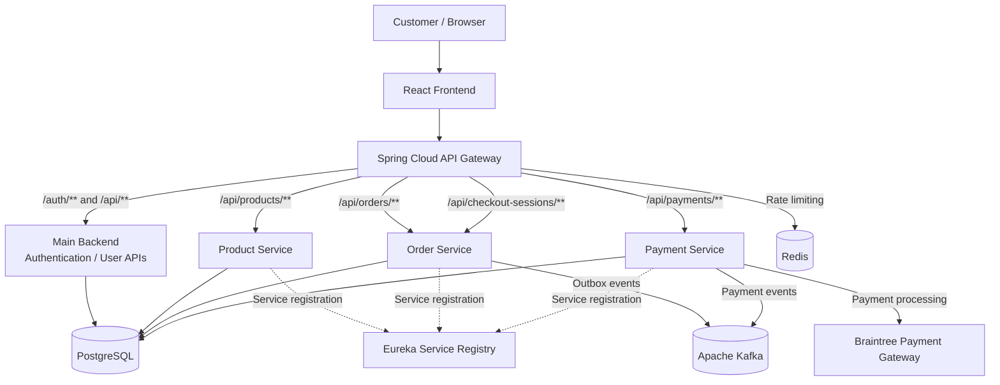

# E-Commerce Microservices Platform

A full-stack e-commerce platform built using **Java 21, Spring Boot, Spring Cloud, React, PostgreSQL, Redis, Apache Kafka, and Docker**.

This project demonstrates the design and implementation of a distributed e-commerce application using independently developed microservices, API Gateway routing, service discovery, secure authentication, durable checkout, payment processing, and event-driven communication.

The project is maintained across seven independent GitHub repositories, with this repository serving as the central project overview and documentation hub.

---

## Architecture Overview

The platform consists of a React frontend, an API Gateway, and independently deployable backend services.

The architecture also includes Docker-based infrastructure, monitoring, metrics collection, and distributed tracing.

## Microservices and Repositories

Each component is maintained in its own GitHub repository.

| Component | Responsibility | Repository |
|---|---|---|
| Main Backend | Original Spring Boot application, user authentication and supporting APIs | [demo-app](https://github.com/fahadnizamani/demo-app) |
| React Frontend | E-commerce user interface, authentication, products, cart, checkout and payment experience | [ecommerce-frontend](https://github.com/fahadnizamani/ecommerce-frontend) |
| API Gateway | Centralized routing, Redis rate limiting, circuit breaker, CORS and request handling | [spring-cloud-api-gateway](https://github.com/fahadnizamani/spring-cloud-api-gateway) |
| Product Service | Product management and product APIs | [spring-product-service](https://github.com/fahadnizamani/spring-product-service) |
| Order Service | Order management, durable checkout sessions and transactional outbox | [order-service](https://github.com/fahadnizamani/order-service) |
| Payment Service | Payment attempts, Braintree integration, payment processing and payment events | [payment-service](https://github.com/fahadnizamani/payment-service) |
| Service Registry | Eureka-based service registration and discovery | [eureka-service-registry](https://github.com/fahadnizamani/eureka-service-registry) |

---

## Technology Stack

### Backend
- Java 21
- Spring Boot
- Spring Security
- Spring Data JPA / Hibernate
- Spring Cloud
- Spring Cloud Gateway
- Netflix Eureka
- REST APIs
- Maven

### Frontend
- React
- JavaScript
- HTML5
- CSS3

### Database and Caching
- PostgreSQL
- Redis
- Spring Cache
- Redis-based JWT token blacklisting

### Messaging and Event-Driven Architecture
- Apache Kafka
- Kafka UI
- Transactional Outbox Pattern
- Asynchronous service-to-service communication
- Idempotent payment operations

### Payment Integration
- Braintree
- Payment attempt persistence
- Idempotency keys
- Payment status management
- Payment processing and recovery

### API Gateway and Resilience
- Spring Cloud Gateway
- Eureka service discovery
- Redis-backed request rate limiting
- IP-based authentication rate limiting
- User-based API rate limiting
- Resilience4j circuit breaker
- Product Service fallback routing
- Centralized CORS configuration

### DevOps and Observability
- Docker
- Docker Compose
- GitHub Actions
- Docker Hub
- Prometheus
- Grafana
- Jaeger
- OpenTelemetry
- Micrometer Tracing
- Spring Boot Actuator

### Kubernetes
- Kubernetes fundamentals
- Pods, Deployments and Services
- Service exposure and scaling concepts

---

## Key Features

### Authentication and Security
- User registration and login.
- JWT-based authentication.
- Role-based authorization.
- Protected API endpoints.
- Redis-based token blacklisting.
- Centralized API Gateway request handling.

### Product and Shopping Cart
- Product listing and management.
- Product details.
- Shopping cart management.
- Cart item quantity and subtotal calculations.

### Durable Checkout
- Persistent checkout sessions.
- Checkout session recovery.
- Synchronization of draft orders with the latest cart.
- Protection of order snapshots during payment processing.
- Handling of failed payment retries.
- Idempotent payment initiation.

### Payment Processing
- Braintree payment integration.
- Payment attempt persistence.
- Idempotency-key handling.
- Payment status tracking.
- Payment recovery and retry handling.

### Event-Driven Architecture
- Kafka-based asynchronous communication.
- Transactional Outbox Pattern.
- Reliable event publishing.
- Idempotent event creation.
- Order and payment event processing.

### API Gateway
- Centralized routing to backend services.
- Eureka-based service discovery.
- Redis-backed rate limiting.
- IP-based and user-based rate-limit strategies.
- Resilience4j circuit breaker for Product Service.
- Product Service fallback endpoint.
- Centralized CORS configuration.

### Monitoring and Observability
- Spring Boot Actuator endpoints.
- Prometheus metrics.
- Grafana dashboards.
- Distributed tracing with Jaeger.
- OpenTelemetry and Micrometer Tracing.
- Circuit-breaker monitoring.

---

## Durable Checkout and Payment Workflow

The checkout workflow supports persistent sessions and prevents draft checkout activity from being treated as a completed order.

High-level flow:

1. The customer opens Checkout.
2. The Order Service creates or recovers a durable checkout session and draft Order.
3. Changes to the shopping cart are synchronized with the draft Order before payment starts.
4. The customer initiates payment through the React frontend and Braintree integration.
5. The Payment Service persists the payment attempt with idempotency protection.
6. The Order Service creates the `ORDER_CREATED` outbox event after confirming that the payment attempt was persisted.
7. The outbox publisher publishes the event to Kafka.
8. Payment processing events are communicated asynchronously between services.

This approach separates checkout preparation from actual payment initiation and helps prevent premature or duplicate event creation.

---

## API Gateway

The API Gateway runs on port `8081` and provides centralized routing to backend services.

| Route | Destination |
|---|---|
| `/auth/**` | Main backend |
| `/api/products/**` | Product Service |
| `/api/orders/**` | Order Service |
| `/api/payments/**` | Payment Service |
| `/api/checkout-sessions/**` | Order Service |
| `/api/**` | Main backend |

Additional gateway capabilities:

- Redis-backed authentication rate limiting using an IP key resolver.
- Redis-backed general API rate limiting using a user key resolver.
- Resilience4j circuit breaker for Product Service.
- Product Service fallback routing.
- Eureka-based service discovery.
- CORS configuration for the React development frontend.
- Actuator health, metrics, Prometheus and circuit-breaker endpoints.
- OTLP distributed tracing configuration.

The rate-limiter configuration currently uses a replenish rate of 3 and burst capacity of 5 for authentication requests, and a replenish rate of 20 and burst capacity of 40 for general API requests.

---

## Event-Driven Communication

The platform uses Apache Kafka for asynchronous communication between services.

The Order Service uses a transactional outbox approach to record events reliably before they are published.

The Payment Service also includes payment event and outbox-related components.

This architecture helps separate synchronous API requests from asynchronous processing and supports reliable event delivery and recovery.

---

## Running the Project

The project is developed and maintained as seven separate repositories.

For local development, each repository contains its own application code and configuration. Refer to the individual repository documentation for service-specific setup instructions.

The previous development workspace used a combination of Docker infrastructure and Spring Boot applications launched from IntelliJ.

Infrastructure and service configuration may evolve as the platform develops. Refer to the latest service configuration before using local ports, environment variables or Docker commands.

---

## Project Goals

This project demonstrates practical experience with:

- Java full-stack development.
- Spring Boot application development.
- Microservices architecture.
- Distributed systems and service communication.
- API Gateway and service discovery.
- Authentication and authorization.
- Payment gateway integration.
- Database transactions and migrations.
- Kafka and event-driven architecture.
- Transactional outbox and idempotency.
- Caching and rate limiting.
- Resilience and fault handling.
- Docker-based development.
- CI/CD automation.
- Monitoring and distributed tracing.

The project is continuously evolving as new features, reliability improvements and architectural enhancements are implemented.

---

## Author

**Fahad Nizamani**

GitHub: [github.com/fahadnizamani](https://github.com/fahadnizamani)